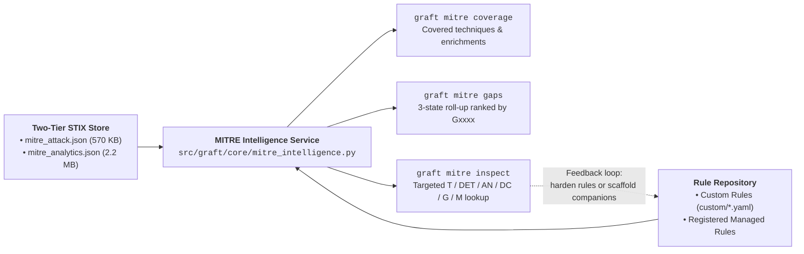

# Visibility, Threat Matrix & Catalog Tooling

Graft turns detection repositories into high-visibility threat intelligence and coverage assets. Detection engineers, CTI analysts, SOC managers, and compliance auditors can inspect MITRE ATT&CK enrichments, compute 3-state coverage gaps, export ATT&CK Navigator heatmaps, and generate Git-attributed rule catalogs directly from the command line—100% offline.

---

## 1. Two-Tier Pre-Compiled MITRE ATT&CK Storage & Version Management

Graft ships with pre-compiled MITRE ATT&CK Enterprise STIX data in `src/graft/data/` (currently pinned to **v20.0**) so users and CI/CD pipelines never have to download raw 40 MB STIX bundles during onboarding or routine runs.

To keep daily operations (`graft lint`, `graft mitre coverage`, `graft export`) sub-second while still providing deep detection blueprints on demand, Graft splits the taxonomy into two files:
- **`src/graft/data/mitre_attack.json` (~570 KB):** Core techniques, sub-techniques, tactics, platforms, revocation/deprecation pointers (`revoked_by`, `status`), Detection Strategy summaries (`DETxxxx`), Data Components (`DCxxxx`), Threat Groups (`Gxxxx`), and Mitigations (`Mxxxx`). Loaded by `graft lint`, `graft mitre coverage`, `graft mitre gaps`, and `graft export`.
- **`src/graft/data/mitre_analytics.json` (~2.2 MB):** Full platform-specific behavioral analytics (`ANxxxx`), log source channel mappings (`log_sources`), and tunable parameters (`mutable_elements`). Lazy-loaded **only** when `graft mitre inspect` is invoked with `--analytics`, `--full`, or a `DETxxxx`/`ANxxxx` ID.

> [!TIP]
> **Bumping MITRE ATT&CK Versions (`graft mitre update`):**
> Graft never hardcodes the MITRE version in application logic—every validator, report header, and Navigator layer reads `version` dynamically from `src/graft/data/mitre_attack.json`.
> - **Check for upstream releases (fast, 33 KB index lookup):**
>   ```bash
>   uv run graft mitre update --check
>   ```
>   *(Also runs non-blockingly in `.githooks/pre-commit` and CI so maintainers are notified when MITRE publishes a new version).*
> - **Upgrade to the latest upstream Enterprise ATT&CK release (or a specific version):**
>   ```bash
>   uv run graft mitre update
>   # or pin a specific version / custom STIX bundle URL:
>   uv run graft mitre update --version 20.0
>   ```
>   Running `graft mitre update` recompiles both `mitre_attack.json` and `mitre_analytics.json` deterministically so you can immediately run `uv run graft lint` to see if any mapped techniques were newly revoked or deprecated.

---

## 2. MITRE ATT&CK Intelligence & CTI Analysis (`graft mitre`)

While `graft export` generates portable artifacts for external tools, `graft mitre` is the interactive CLI workspace for detection engineers, CTI analysts, and AI skills (`/analyze-coverage`, `/scaffold-rule`, `/review-rule`).



### How to Reason About MITRE ATT&CK Coverage in Graft

Before interpreting `graft mitre coverage`, `graft mitre gaps`, or an ATT&CK Navigator heatmap, operators and leadership must understand three foundational realities of detection coverage:

#### 1. Techniques as a Relational Foreign Key & The Calibration Problem
Adversaries do not plan operations by consulting the MITRE ATT&CK matrix; they chain opportunistic actions to achieve objectives. ATT&CK is a **defender's taxonomy** designed so CTI, detection engineering, purple teams, and leadership speak a common language.

- **Subjectivity at the Entry Point:** Mapping a detection rule to `metadata.mitre` is inherently subjective—two analysts looking at the same behavior will rarely map the exact same techniques (`==`). Teams should reduce variance through joint mapping exercises, peer review in Git pull requests, and consistent review guardrails (`/review-rule`, `/scaffold-rule`).
- **The Technique ID (`Txxxx.xxx`) as a Foreign Key:** Once a rule has a calibrated `Txxxx.xxx` mapping, Graft treats that ID as a **relational foreign key** into the STIX graph. Without bloating rule YAML files, Graft joins `Txxxx.xxx` against STIX relationships to pull Threat Groups (`Gxxxx`), Detection Strategies (`DETxxxx`), behavioral Analytics (`ANxxxx`), required Data Components (`DCxxxx`), and Mitigations (`Mxxxx`).
- **The Engineering Feedback Loop:** The true purpose of those relationships is not a static executive scorecard—it is an iterative feedback loop. Inspecting a mapped technique's relationships (`graft mitre inspect <Txxxx.xxx> --analytics`) exposes its behavioral strategies, log channels, and tunable `mutable_elements`, giving engineers concrete insights to **harden the existing rule** or **author companion rules** for sibling procedures.

#### 2. The 3-Pillar Coverage Model vs. Graft's Partial View (No CMDB)
True, precise coverage requires the intersection of three distinct datasets:
1. **Rule Data (What you detect):** Active (`enabled` or `silent`) detection logic in `rulesets/`.
2. **CTI Data (How adversaries operate):** Global STIX relationships (built into Graft), narrowed to your organization's threat profile (`--group`).
3. **CMDB & Telemetry Inventory (What exists in your environment):** The authoritative inventory of platforms, cloud providers, operating systems, identity planes, and log channels running in production.

Because Graft is a Detection-as-Code platform rather than a CMDB, it operates offline with **only two of the three pillars** (Rule Data + MITRE CTI Data). Without a CMDB, rule-only analysis faces the **Zero-Rule Ambiguity**: if your repository has `IaaS` and `Office Suite` rules but **zero** `Linux` rules, Graft cannot tell whether you *do not run Linux* (out of scope) or *run Linux everywhere with zero detections* (a 100% blind spot).
- **Guessing from Rules Present (`--infer-scope`):** By joining active rules' mapped techniques against STIX, Graft infers which **platforms** and **data components (`DCxxxx`)** your SIEM is already proven to ingest, finding gaps *within known surfaces*.
- **Operator-Supplied Scope (`--platform`, `--data-component`, `--group`, `--tactic`):** When evaluating a surface where you have zero rules today—or targeting a specific threat actor (`--group`)—you act as the CMDB by supplying explicit CLI filter flags.

#### 3. The Procedure Fallacy (Why TT Matrices Become Misinformation)
Even with a perfect CMDB, the MITRE ATT&CK matrix—and any ATT&CK Navigator heatmap—stops at **Tactics and Techniques (TT)**. It stops above the second **P** in **TTPs: Procedures**:
- **One Technique $\neq$ One Behavior:** Beneath a single technique cell (`Txxxx.xxx`) sit many distinct adversary **Procedures**—specific tools, CLI flags, API calls, OS mechanisms, and cloud control planes.
- **Single-Tool / Single-Perimeter Illusion:** You might write one rule mapped to `T1098.001` (*Additional Cloud Credentials*) that detects GCP Service Account key creation, or one endpoint rule under `T1003.001` that catches `mimikatz.exe`. In a table or CISO heatmap, that technique cell turns green (`covered`). If an adversary switches to another tool, or creates an AWS IAM access key in your AWS environment under the exact same `T1098.001` technique, your detection fails. Treating a green technique cell as complete protection turns coverage metrics into **misinformation**.
- **How to Audit Depth:** Always treat `covered` in Graft as **"at least one active rule maps to this technique ID"**—an index pointer to begin auditing procedural and multi-perimeter depth via `graft mitre inspect <Txxxx.xxx> --analytics` and `/analyze-coverage`.

### 1. Coverage Summary & Enrichments (`graft mitre coverage`)
Inspect covered techniques across all engines (or filtered by `--engine`, `--platform`, `--group`, or `--data-component`). Pass `--enrich` to surface associated Threat Groups (`Gxxxx`), Detection Strategies (`DETxxxx`), Data Components (`DCxxxx`), and Mitigations (`Mxxxx`):

```bash
# Default coverage table
uv run graft mitre coverage

# Enriched coverage table filtered to IaaS techniques
uv run graft mitre coverage --platform IaaS --enrich

# Machine-readable JSON or CSV for CTI skills and pipelines
uv run graft --json mitre coverage --enrich
uv run graft mitre coverage --format csv --enrich --out exports/mitre_coverage.csv
```

**Example Output (`graft mitre coverage --enrich`):**
```text
MITRE ATT&CK v20.0 Coverage (Total Rules: 6 | Covered Techniques: 8)
======================================================================================================================
Technique ID  Technique Name             Rules Groups Strategies   Data Components    Rules / Detections
----------------------------------------------------------------------------------------------------------------------
T1018         Remote System Discovery    1     43     DET0574      DC0032,DC0055      multiple_hosts_scanned
T1046         Network Service Discovery  1     33     DET0376      DC0032,DC0078      multiple_ports_scanned
T1071.001     Web Protocols              1     58     DET0027      DC0032,DC0064      gcti_breach_network_indic...
T1078.004     Cloud Accounts             1     14     DET0546      DC0002,DC0067      gcp_storage_bucket_public...
T1098.001     Additional Cloud Credent.. 1     1      DET0531      DC0010,DC0066      gcp_service_account_key_c...
T1566.002     Spearphishing Link         1     48     DET0107      DC0032,DC0038      workspace_nrd_email_opened
T1595.001     Scanning IP Blocks         2     2      DET0817      DC0078,DC0085      multiple_hosts_scanned, m...
T1685         Disable or Modify Tools    1     33     DET0497      DC0018,DC0032      gcp_storage_bucket_public...
```

### 2. Three-State Gap Analysis (`graft mitre gaps`)
Compute prioritized detection gaps across the MITRE ATT&CK matrix using a **3-state parent/sub-technique roll-up** (`covered`, `partial`, `uncovered`) ranked by Threat Group (`Gxxxx`) prevalence.

#### How "In Scope" (`In Scope: N`) Is Defined
`graft mitre gaps` starts with the universe of all **active Enterprise ATT&CK techniques and sub-techniques** in `src/graft/data/mitre_attack.json` (706 in v20.0; synthetic `T0000`, `revoked`, and `deprecated` techniques are excluded). It narrows that universe **strictly by the CLI filter flags you pass** (intersected with `AND`):
- **No filter flags (`graft mitre gaps`):** All active Enterprise techniques and sub-techniques across all 9 MITRE platforms (`Windows`, `Linux`, `macOS`, `IaaS`, `SaaS`, `Office Suite`, `Identity Provider`, `Network Devices`, `Containers`) are in scope. Graft never restricts platforms silently when flags are omitted, but prints a `Rule-Inferred Footprint` header line showing the platforms and `DCxxxx` data components inferred from your active rules.
- **`--infer-scope`:** Automatically restricts `In Scope` to techniques matching the MITRE platforms and `DCxxxx` data components already proven by your repository's active rules (ideal for finding gaps inside known, actively ingested surfaces).
- **`--platform <name>`:** Keeps only techniques whose STIX `x_mitre_platforms` includes that platform (e.g., `--platform IaaS` narrows 706 down to 104).
- **`--group <G-ID or alias>`:** Keeps only techniques used by that Threat Group in STIX (`uses` relationships).
- **`--data-component <DC-ID or name>`:** Keeps only techniques linked to a `DETxxxx` strategy that uses that `DCxxxx` data component.
- **`--tactic <TA-ID or shortname>`:** Keeps only techniques belonging to that tactic.

#### How "Covered" & the 3-State Roll-Up Are Evaluated
Graft collects all technique IDs mapped in `metadata.mitre` across **active** (`enabled` and `silent`, excluding `disabled` and `_archived/`) rules in `rulesets/` (or `--engine <name>`), including both `custom/*.yaml` and registered `managed/<rule>.yaml`. Each in-scope technique is then classified based on the parent/sub-technique hierarchy within the evaluated scope:

| Technique Type | `covered` | `partial` | `uncovered` |
| :--- | :--- | :--- | :--- |
| **Parent with in-scope sub-techniques** (e.g. `T1078`) | **Every** in-scope sub-technique (`T1078.xxx`) is covered by an active rule | Either only parent `T1078` is mapped, **or** at least one (but not all) in-scope sub-technique is covered (e.g. `T1078.004` is covered while `.001`/`.002`/`.003` are not) | Neither parent `T1078` nor any of its sub-techniques is covered |
| **Sub-technique** (e.g. `T1098.001`) | `T1098.001` is directly mapped in an active rule | `T1098.001` is not mapped, **but** an active rule mapped parent `T1098` generically | Neither `T1098.001` nor parent `T1098` is mapped |
| **Standalone technique (no sub-techniques)** (e.g. `T1685`) | `T1685` is mapped in an active rule | *(N/A)* | `T1685` is not mapped in any active rule |

#### Ranking, Slicing (`--top`), and Operational Nuances
1. **Ranking & Slicing:** Techniques evaluating to `covered` are omitted from the gap table. Remaining `partial` and `uncovered` techniques are sorted by **`(-group_count, 0 if state == "uncovered" else 1, technique_id)`** so techniques abused by the most MITRE Threat Groups (`Gxxxx`) appear first. `--top N` (default `25` in table mode; unsliced in JSON/CSV/Markdown) slices the displayed rows while keeping the header totals (`In Scope | Covered | Partial | Uncovered`) across the full in-scope set.
2. **Both Parents and Sub-Techniques Count in `In Scope`:** Both parent techniques (`T1078`) and their in-scope sub-techniques (`T1078.001..004`) are evaluated in `In Scope`. Because STIX frequently attaches Threat Group relationships (`Gxxxx`) to the parent technique ID, a `partial` parent like `T1078` (49 groups) will surface near the top alongside its `uncovered` sibling sub-techniques while covered sub-techniques (`T1078.004`) are counted in `Covered`.
3. **Rule Deployment Status (`enabled` / `silent` vs. `disabled`):** Rules with status `disabled` (`deployment.enabled: false` or disabled in `managed/index.yaml`) are **excluded** from counting toward `covered` in `graft mitre gaps`, `graft mitre inspect`, and `graft export navigator --include-gaps` so inactive rules never hide gaps. Both `enabled` (alerting) and `silent` (`enabled: true, alerting: false`) rules count as active coverage; cross-check `graft export catalog` to verify whether a covered technique relies on a `silent` rule.

```bash
# Gaps within the platforms and DCxxxx log sources inferred from your active rules
uv run graft mitre gaps --infer-scope --top 10

# Top 10 uncovered/partial gaps on IaaS ranked by Threat Group prevalence
uv run graft mitre gaps --platform IaaS --top 10

# Gaps for a specific Threat Group (by G-ID or alias/name)
uv run graft mitre gaps --group APT29 --platform IaaS

# "Quick-win" gaps that rely on a Data Component (DCxxxx) your SIEM already ingests
uv run graft mitre gaps --data-component DC0010 --top 10
```

**Example Output (`graft mitre gaps --platform IaaS --top 5`):**
```text
MITRE ATT&CK v20.0 Gap Analysis [platform=IaaS]
In Scope: 104 | Covered: 4 | Partial: 3 | Uncovered: 97 (Showing 5 gaps)
================================================================================================================
Technique ID  State      Groups  Technique Name                 Strategies   Data Components
----------------------------------------------------------------------------------------------------------------
T1082         uncovered  59      System Information Discovery   DET0525      DC0032, DC0063, DC0064
T1078         partial    49      Valid Accounts                 DET0560      DC0002, DC0032, DC0067
T1190         uncovered  47      Exploit Public-Facing Applic.. DET0080      DC0016, DC0032, DC0038
T1049         uncovered  33      System Network Connections D.. DET0320      DC0021, DC0032, DC0064
T1518.001     uncovered  27      Security Software Discovery    DET0016      DC0016, DC0032, DC0064
```

### 3. Targeted Entity & Analytic Inspection (`graft mitre inspect`)
Query specific MITRE entities (`Txxxx[.xxx]`, `TAxxxx`, `DETxxxx`, `ANxxxx`, `DCxxxx`, `Gxxxx`, `Mxxxx`, or Threat Group name/alias) without loading full STIX files. Pass `--analytics` (or `--full`) to lazy-load platform-specific `ANxxxx` analytics, `log_sources`, and tunable `mutable_elements`:

```bash
# Inspect a technique with its IaaS analytics, log sources, and tunable parameters
uv run graft mitre inspect T1098.001 --analytics --platform IaaS

# Inspect a Detection Strategy, Analytic, Threat Group, or Data Component directly
uv run graft mitre inspect DET0531 AN1470 G0016 DC0010

# Structured JSON output for AI skills (/analyze-coverage, /scaffold-rule, /review-rule)
uv run graft --json mitre inspect T1098.001 --analytics --platform IaaS
```

---

## 3. MITRE ATT&CK Navigator Layer Export (`graft export navigator`)

Generate JSON layers adhering to the MITRE ATT&CK Navigator v4.5 specification (`graft export navigator`, with `graft export matrix` and `graft export mitre` supported as aliases):

```bash
# Export unified Navigator JSON layer (default format for 'export navigator' is navigator JSON)
uv run graft export navigator --out exports/graft_coverage.json

# Export engine-scoped layer with custom gradient color
uv run graft export navigator --engine secops --color "#4285F4" --out exports/secops_coverage.json

# Export filtered Navigator layer with STIX enrichments and partial (#fff8e1) / uncovered (#ffebee) gaps (score 0)
uv run graft export navigator --platform IaaS --enrich --include-gaps --out exports/iaas_posture.json

# Backward-compatible matrix alias (supports --format table | navigator)
uv run graft export matrix --format table --engine secops
```

Import the generated JSON file directly into the [MITRE ATT&CK Navigator Web App](https://mitre-attack.github.io/attack-navigator/) to visualize detection coverage heatmaps, inspect rule metadata and `DETxxxx`/`DCxxxx`/`Gxxxx` enrichments (`--enrich`), and highlight uncovered blind spots (`--include-gaps`).

### Multi-Engine Gap Analysis in MITRE Navigator
Operators managing hybrid detection platforms (e.g. Google SecOps and endpoint security) can export distinct layers per engine using `--engine <name>` and `--color <hex>`, then leverage Navigator's layer combination arithmetic for automated gap analysis.

For an in-depth breakdown of Navigator layer expressions and visual gap analysis, see:
👉 **[Gap Analysis with MITRE Navigator](https://lopes.id/log/gap-analysis-mitre-navigator/)**

Each technique in the exported layer is scoped strictly to its tactic shortname (e.g. `initial-access`, `defense-impairment`) with `selectTechniquesAcrossTactics: false`, ensuring scores remain locked to their appropriate tactic column. Combining layers using Navigator's **Create Layer from Other Layers** feature enables:
- **Redundancy Evaluation (`min(a, b)`):** Highlights techniques defended by multiple engines simultaneously.
- **Combined Coverage (`max(a, b)`):** Surfaces the complete detection footprint.
- **Normalized Gap Analysis (`1 + 4 * (1 - (max(a, b) * (1 - min(a, b))))`):** Normalizes coverage to a 1–5 scale where score 1 exposes single-engine dependencies as high-priority blind spots, while score 5 rewards defense-in-depth redundancy.

---

## 4. Operational Ownership & Git Lifecycle Provenance

Graft separates operational accountability (`metadata.owners` in the rule YAML) from historical revision provenance extracted from Git in a single pass (`git log --follow --format=%aI%x00%aN%x00%aE`) via Python's standard library `subprocess`:

- **Initial Committer (`author`):** Author name (`%aN`) of the earliest commit in the file's history across renames.
- **Accountable Owners (`owners` & `owner_count`):** Sourced directly from `metadata.owners` in the rule envelope to identify the teams or individuals responsible for maintaining the rule today, paired with `owner_count` (`len(metadata.owners)`) to surface single-owner bus-factor risk.
- **Creation Date (`created_at`):** Earliest commit timestamp across file history, normalized to UTC `YYYY-MM-DD` for native date parsing in Polars and Google Sheets.
- **Last Modified Date (`last_modified_at`):** Most recent commit timestamp across file history, normalized to UTC `YYYY-MM-DD`.
- **Commit Revision Count (`review_count`):** Total number of commits touching the file across renames (`--follow`).
- **Contributor Breadth (`contributor_count`):** Count of distinct, case-insensitively normalized Git author emails (`%aE`) touching the file. Credit external research authors in `metadata.references`.
- **Offline / Untracked Fallback:** Automatically falls back to `"Unknown"` strings and `0` counts if files are uncommitted or executed in environments lacking Git history (e.g. container builds).

---

## 5. Rule Catalog Generation (`graft export catalog`)

Export comprehensive detection catalogs enriched with deployment status, MITRE ATT&CK associations, accountable rule owners, and Git lifecycle metrics across multiple formats (`table`, `markdown`, `csv`, `json`). Pass `--enrich` to append MITRE `platforms`, `detection_strategies`, `data_components`, `groups`, and `mitigations` to each rule entry.

### Terminal Table (`--format=table`, Default)
Fast, on-screen inspection without piping to files:

```bash
uv run graft export catalog
# or with MITRE STIX enrichments:
uv run graft export catalog --enrich
```

### Markdown Catalog (`--format=markdown`)
Ideal for automated documentation generation and repository wiki tracking:

```bash
uv run graft export catalog --format=markdown --out docs/RULE_CATALOG.md
```

| Rule Name | Engine | Type | Status | MITRE ATT&CK | Author | Owners | Owner Count | Created | Last Updated | Reviews | Contributors |
| --- | --- | --- | --- | --- | --- | --- | --- | --- | --- | --- | --- |
| `gcp_service_account_key_created` | secops | custom | enabled | TA0003:T1098.001, TA0004:T1098.001 | Joe Lopes | Joe Lopes | 1 | 2026-09-17 | 2026-10-01 | 13 | 1 |
| `gcp_storage_bucket_public_access_granted` | secops | custom | enabled | TA0001:T1078.004, TA0112:T1685 | Joe Lopes | Joe Lopes | 1 | 2026-09-17 | 2026-10-01 | 11 | 1 |
| `workspace_nrd_email_opened` | secops | custom | enabled | TA0001:T1566.002 | Joe Lopes | Joe Lopes | 1 | 2026-09-17 | 2026-10-01 | 9 | 1 |
| `gcti_breach_network_indicator_matched` | secops | managed | silent | TA0011:T1071.001 | Joe Lopes | Joe Lopes | 1 | 2026-09-30 | 2026-10-01 | 2 | 1 |

### CSV Catalog (`--format=csv`)
Generate spreadsheet-ready exports for Polars, Google Sheets, security audits, and reporting pipelines:

```bash
uv run graft export catalog --format=csv --out exports/detection_catalog.csv
```

By default, CSV exports contain 15 normalized fields:
`id, name, engine, rule_type, status, description, mitre_attack, tags, author, owners, owner_count, created_at, last_modified_at, review_count, contributor_count` (plus `mitre_platforms, mitre_strategies, mitre_data_components, mitre_groups, mitre_mitigations` when `--enrich` is passed).

### JSON Catalog (`--format=json`)
Structured JSON for feeding security data lakes, BigQuery, or internal developer portals:

```bash
uv run graft export catalog --format=json
uv run graft export catalog --format=json --enrich
```
