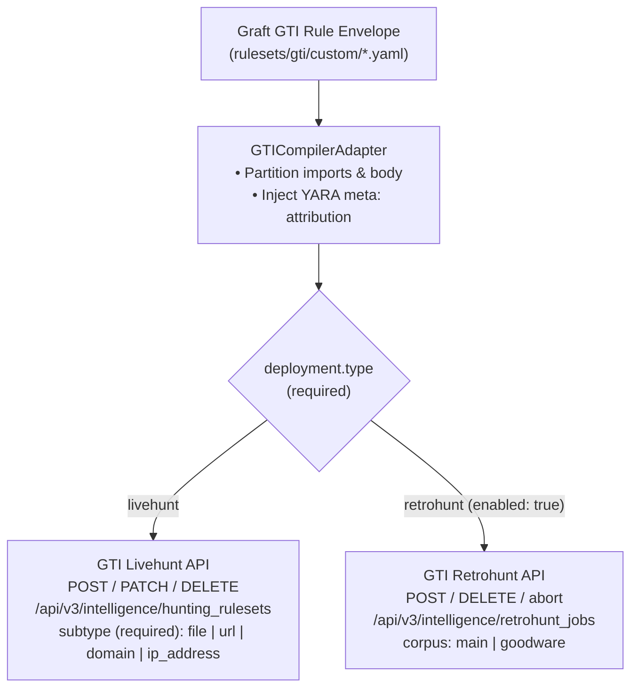

# Google Threat Intelligence (`gti`) Engine Setup & Operations Guide

The `gti` adapter connects Graft to the **Google Threat Intelligence (VirusTotal v3)** REST API (`https://www.virustotal.com/api/v3`), bringing native YARA-X **Livehunt** rulesets (`/api/v3/intelligence/hunting_rulesets`) and **Retrohunt** historical corpus jobs (`/api/v3/intelligence/retrohunt_jobs`) into peer-reviewed GitOps workflows and unified MITRE ATT&CK coverage matrices.

---

## 1. What Graft Commands & Deploys in GTI



| Artifact / Capability | Supported in `gti`? | How Graft Handles It |
| :--- | :---: | :--- |
| **Livehunt Rulesets** (`deployment.type: "livehunt"`) | **Yes** (`custom_rules: true`) | Synchronized via `graft gti diff`, `apply`, and `pull` against `/api/v3/intelligence/hunting_rulesets`. Continuously evaluates incoming GTI submissions in real time across 4 explicit entity subtypes (`deployment.subtype`: `"file"`, `"url"`, `"domain"`, `"ip_address"`). |
| **Retrohunt Jobs** (`deployment.type: "retrohunt"`) | **Yes** (`custom_rules: true`, `replay_testing: true`) | Configured declaratively under `deployment` (`type: "retrohunt"`, `corpus: "main" \| "goodware"`, optional `start_time`, `end_time`). Kept dormant in Git while `enabled: false` (still linted, syntax-verified, unit-tested, and cataloged) and submitted to `/api/v3/intelligence/retrohunt_jobs` when `enabled: true` is applied. Also runnable on-demand via `graft gti test`. |
| **Reusable String Datasets** (`datasets/<name>.yaml`) | **No** (`datasets: false`) | GTI's YARA-X engine does not provide a server-side lookup table or reference list resource (`DatasetPort` is disabled). GTI rules use 100% native YARA-X without Graft preprocessor hacks; `graft lint` rejects `%<dataset>` tokens in `rulesets/gti/`. |
| **Vendor-Managed Rules** (`rulesets/gti/managed/`) | **No** (`managed_rules: false`) | GTI does not expose vendor-managed curated rulesets on `/intelligence/hunting_rulesets` (`ManagedEnginePort` is disabled). All rulesets visible in a shared GTI organization are user-created (`owner.type == "user"`). |

---

## 2. Environment Configuration & Shared Organization Safety

Copy [`.env.example`](../.env.example) to `src/graft/engines/gti/.env` (automatically loaded by Graft at startup and excluded from Git via `.gitignore`):

```bash
export GRAFT_GTI_API_KEY="your-gti-api-key"
# Optional discovery scope: "tag:graft" (default), "owner:self", or "all"
export GRAFT_GTI_FILTER="tag:graft"
# Optional default notification recipients for Livehunt / Retrohunt matches
export GRAFT_GTI_NOTIFICATION_EMAILS="soc-alerts@example.com"
```

### Shared GTI Organization Scoping, Team Sync & Migrating Existing Rules
In GTI, Livehunt rulesets are created at the user level (`owner.type == "user"`), while everyone in the same organization can see all rulesets across the org. To keep team GitOps clean without touching unrelated rulesets in a shared organization:

- **Automatic `graft` Tagging (`GRAFT_GTI_FILTER="tag:graft"`, Default):** Every rule created or updated by Graft is automatically tagged with `graft` in GTI (and stamped with `graft_id` in YARA `meta:`). During `diff`, `apply`, and `pull`, Graft queries `/api/v3/intelligence/hunting_rulesets?filter=tag:graft`.
  - **Team Collaboration:** If you add 1 rule and a colleague adds 1 rule to the repo, GTI holds those 2 `graft`-tagged rules. When anyone pulls the repo and runs `graft gti diff --all`, Graft sees both rules (`0` drift) and ignores all other non-Graft rulesets in the organization.
  - **Migrating Existing GTI Rules:** To bring an existing GTI ruleset under Graft management, simply add the `graft` tag to it in GTI and run `uv run graft gti pull`. Graft will pull and deconstruct it into `rulesets/gti/custom/<name>.yaml`.
- **Personal Sandbox Scope (`owner:self`):** Set `GRAFT_GTI_FILTER="owner:self"` to scope discovery strictly to rulesets owned by your API key (`/api/v3/users/{user_id}/hunting_rulesets`), or `"all"` for read-only org-wide inspection.
- **Hard Read-Only Ownership Guard:** [`GTIDeployerAdapter`](../deployer.py) checks `owner_id == current_user_id` before any `PATCH` or `DELETE` request and raises a `403 OwnershipGuardError` if a mutation targets another user's ruleset. For shared production repos where any teammate can update any rule via PRs, run `graft gti apply` with a single shared service/automation GTI API key so all Graft rules share one owner.

---

## 3. Configuring `deployment`: Livehunt vs. Retrohunt

In Graft, [`BaseDeploymentConfig`](../../../core/models/rule.py) in Core is completely empty—every engine defines and validates its own `deployment` block via [`schemas/custom.schema.json`](../schemas/custom.schema.json).

The `gti` schema requires `deployment.type` (`"livehunt"` or `"retrohunt"`) and `deployment.enabled` (`boolean`) on every rule—with zero implicit defaults or stream guessing:

### Mode A: Livehunt Deployment (`type: "livehunt"`)
Evaluates newly submitted files, URLs, domains, or IP addresses in real time:

```yaml
deployment:
  type: "livehunt"
  subtype: "url"
  enabled: true
  daily_limit: 100
  notification_emails:
    - "soc-alerts@example.com"
```

| Field | Type & Constraints | Description |
| :--- | :--- | :--- |
| `type` | `"livehunt"` (**required**) | Selects GTI Livehunt (`/api/v3/intelligence/hunting_rulesets`). |
| `subtype` | `"file" \| "url" \| "domain" \| "ip_address"` (**required**) | Entity stream evaluated by Livehunt (`attributes.match_object_type` in GTI JSON:API). Must be declared explicitly—Graft never guesses `subtype` from `vt.net.*` identifiers. |
| `enabled` | `boolean` (**required**) | Whether the Livehunt ruleset is actively evaluating incoming GTI submissions. |
| `daily_limit` | `integer` (`1..10000`, optional, default `100`) | Maximum match notifications per 24-hour window (`attributes.limit` in GTI JSON:API). |
| `notification_emails` | `array[string]` (optional) | Email addresses notified when Livehunt records a match. Falls back to `GRAFT_GTI_NOTIFICATION_EMAILS`. |

> [!NOTE]
> Livehunt rules cannot declare Retrohunt-only fields (`corpus`, `start_time`, `end_time`); `graft lint` rejects mixed configurations offline.

### Mode B: Retrohunt Deployment (`type: "retrohunt"`)
Scans GTI's historical file corpus (`"main"` or `"goodware"`) over an optional UTC time window:

```yaml
deployment:
  type: "retrohunt"
  enabled: false
  corpus: "main"
  start_time: "2026-01-01T00:00:00Z"
  end_time: "2026-03-31T23:59:59Z"
  notification_emails:
    - "threat-hunting@example.com"
```

| Field | Type & Constraints | Description |
| :--- | :--- | :--- |
| `type` | `"retrohunt"` (**required**) | Selects GTI Retrohunt (`/api/v3/intelligence/retrohunt_jobs`). |
| `corpus` | `"main" \| "goodware"` (**required**) | `"main"` scans GTI's historical file submissions (~3–12 months); `"goodware"` scans ~1M NSRL known-good files for false-positive benchmarking. |
| `enabled` | `boolean` (**required**) | Controls job submission. When `false`, the rule remains dormant in Git (linted, syntax-verified, unit-tested, and cataloged without consuming Retrohunt job quota). Setting `enabled: true` and running `graft gti apply` submits the batch scan job to GTI. |
| `start_time` | ISO-8601 UTC string (optional) | Lower bound for file submission timestamp (`YYYY-MM-DDTHH:MM:SSZ`), converted to Unix epoch seconds in GTI's `attributes.time_range.start`. |
| `end_time` | ISO-8601 UTC string (optional, requires `start_time`) | Upper bound for file submission timestamp (`YYYY-MM-DDTHH:MM:SSZ`), converted to Unix epoch seconds in GTI's `attributes.time_range.end`. |
| `notification_emails` | `array[string]` (optional) | Email addresses notified when the Retrohunt job finishes (`attributes.notification_email`). |

> [!NOTE]
> Retrohunt rules always scan historical files and cannot declare Livehunt-only fields (`subtype`, `daily_limit`).

---

## 4. Authoring Native YARA-X `logic`

### 1. `$LOGIC_IMPORTS` + `$LOGIC_BODY` Separation
Analysts write only top-level `import "<module>"` statements (`import "vt"`, `import "pe"`, `import "elf"`, `import "math"`, etc.) followed by `strings:` (optional) and `condition:` in `logic`—never a `rule <name> { meta: ... }` wrapper:

```yaml
logic: |
  import "vt"

  condition:
    vt.net.url.new_url and
    not (
      vt.net.domain.root == "example.com" or
      vt.net.domain.root == "example.org"
    ) and
    (
      vt.net.url.raw icontains "login" or
      vt.net.url.raw icontains "signin"
    )
```

### 2. Native YARA-X Synthesis (`graft gti render`)
Running `uv run graft gti render` partitions top-level `import "..."` lines above the `rule <rule_name> { ... }` declaration and injects Graft's attribution and MITRE ATT&CK tags into the YARA `meta:` section:

```yara
import "vt"

rule sso_login_portal_impersonated {
  meta:
    graft_id = "8f14e45f-ceea-467a-a124-000000000001"
    description = "Detects newly observed URLs impersonating corporate SSO login portals outside sanctioned root domains"
    owners = "Threat Intelligence, Detection Engineering"
    mitre_tactic = "initial-access"
    mitre_technique = "T1566.002"

  condition:
    vt.net.url.new_url and
    not (
      vt.net.domain.root == "example.com" or
      vt.net.domain.root == "example.org"
    ) and
    (
      vt.net.url.raw icontains "login" or
      vt.net.url.raw icontains "signin"
    )
}
```

---

## 5. Verification & Replay Testing (`graft gti verify` & `graft gti test`)

### 1. Server-Side YARA-X Verification (`graft gti verify`)
GTI does not expose a dedicated stateless syntax-check endpoint. When `uv run graft --json gti verify` runs:
1. Graft performs an instant local structural check (non-empty `condition:`, balanced `{}` and `()`).
2. If `GRAFT_GTI_API_KEY` is configured, [`GTICompilerAdapter`](../compiler.py) submits a transient **disabled** ruleset (`POST /api/v3/intelligence/hunting_rulesets` with `enabled: false`, explicit `match_object_type`, and name `__graft_verify_<uuid8>__`) to invoke GTI's real server-side YARA-X compiler.
3. A `finally:` block immediately executes `DELETE /api/v3/intelligence/hunting_rulesets/{id}`, guaranteeing zero leftover probe rulesets or live alerts. Any remote compiler line number is adjusted back to the local YAML `logic` line offset.

### 2. Dual-Mode Replay Testing (`graft gti test`)
[`GTIReplayAdapter`](../replay.py) supports two test vector modes in the `tests:` block:

#### Mode 1: Offline Synthetic Unit Tests (Default — Fast, Deterministic, Zero Quota)
Evaluates `vt.net.*`, `vt.metadata.*`, `filesize`, and `strings:` (`sample_text`) in memory against synthetic event payloads:

```yaml
tests:
  - id: "match_unlisted_sso_phishing_url"
    description: "Newly observed URL containing SSO login paths on an external domain triggers a match"
    expect: 1
    events:
      - timestamp: "2026-10-15T12:00:00Z"
        payload:
          vt.net.url.new_url: true
          vt.net.domain.root: "login-verify-portal.test"
          vt.net.url.raw: "https://login-verify-portal.test/sso/login?client_id=corp"
          vt.net.url.downloaded_file.analysis_stats.malicious: 3
```

For file/Retrohunt rules with a `strings:` section and `filesize`, pass `sample_text` and `filesize` in `payload`:

```yaml
tests:
  - id: "match_lsass_minidump_pe_strings"
    description: "PE executable containing MiniDumpWriteDump, lsass.exe, and SeDebugPrivilege matches"
    expect: 1
    events:
      - timestamp: "2026-10-15T12:00:00Z"
        payload:
          vt.metadata.file_type: "vt.FileType.PE_EXE"
          filesize: 204800
          sample_text: "MiniDumpWriteDump dbghelp.dll lsass.exe SeDebugPrivilege"
```

#### Mode 2: On-Demand Live Retrohunt Corpus Tests (`mode: "retrohunt"`)
To test a rule against GTI's live historical file corpus (`"main"` or `"goodware"`) during `graft gti test`, set `mode: "retrohunt"` in the event `payload`:

```yaml
tests:
  - id: "goodware_corpus_zero_false_positives"
    description: "Verify zero false positives against GTI goodware corpus window"
    expect: 0
    events:
      - timestamp: "2026-10-15T12:00:00Z"
        payload:
          mode: "retrohunt"
          corpus: "goodware"
          time_range:
            start: 1767225600
            end: 1769904000
```

Graft submits `POST /api/v3/intelligence/retrohunt_jobs`, polls `GET /api/v3/intelligence/retrohunt_jobs/{id}` until `status` reaches `"finished"` or `"aborted"`, asserts `num_matches == expect`, and deletes the transient Retrohunt job in a `finally:` block.

---

## 6. CLI Operations Reference

```bash
# 1. Scaffold a new GTI custom rule
uv run graft gti new brand_sso_portal_impersonated

# 2. Validate YAML schemas, deployment type/subtype constraints, and MITRE mappings offline
uv run graft --json lint rulesets/gti/

# 3. Render synthesized YARA-X rule offline (with meta: attribution)
uv run graft --json gti render --all

# 4. Verify YARA-X syntax against GTI's server-side compiler
uv run graft --json gti verify --all

# 5. Execute unit test vectors (and any retrohunt test vectors)
uv run graft --json gti test

# 6. Diff and apply Livehunt rulesets and enabled Retrohunt jobs (scoped to tag:graft)
uv run graft --json gti diff --all
uv run graft --json gti apply --all

# 7. Pull existing Graft-tagged Livehunt rulesets & Retrohunt jobs into 5-block YAML envelopes
uv run graft --json gti pull
```
